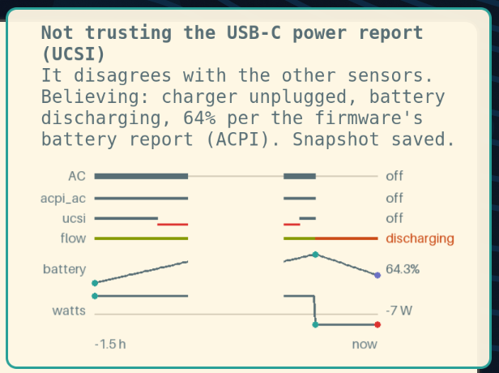

# misra

A laptop has several ways of knowing the same thing, and sometimes they
disagree. The firmware says the battery is gone, the USB-C port says a
100 W charger is plugged in, and the embedded controller says you've been
on battery for an hour. Most status bars believe whichever one they read,
so they show something confident and wrong.

misra cross-checks them. Every 30 seconds, and straight after every resume
from sleep or hibernation, it collects what each sensor claims and works out
the most plausible truth: which sensors are lying, and what's really
happening. Then it:

- writes one state file (`/run/misra/state.json`) for your bar, HUD or
  dashboard to show, with "unknown" where nothing trustworthy knows;
- sends a desktop notification when a sensor starts or stops lying, or when
  the network link starts to struggle and a fallback is in range;
- saves a snapshot of the evidence every time something changes, including
  the firmware tables and EC readings when a new fault appears, so you can
  compare a broken state with a healthy one after you reboot.



*A power alert (example data). Under the words, the last two hours on one time
axis: the heavy line is what misra believes about the charger, the thin lines
are what each sensor claimed, and the red line marks where the USB-C report
disagreed with the belief. Then the battery's flow, its charge and its watts.
The gap is the laptop asleep.*

It is named after the Misra Yantra at Jantar Mantar, the "mixed instrument"
that combines several instruments in one. It's a companion to
[jantar](https://github.com/aaronjohnson/jantar).

## What it checks

| | sensors | it notices |
| --- | --- | --- |
| **power** | firmware battery and charger reports (ACPI), USB-C power delivery (UCSI), the embedded controller (EC), the charge trend over time | readings that contradict each other or physics; firmware methods failing; readings that stopped changing |
| **links** | Wi-Fi signal and its trend, multi-link (MLO) links, roams, drops, beacon loss, internet reachability | a link getting worse before it fails; which configured fallback (Starlink, a phone) is in range |

It watches and advises. It doesn't switch networks or change anything
on the machine.

## How it decides

The decisions are logic rules, not code: [`misra/rules/`](misra/rules)
holds a few dozen lines of [clingo](https://potassco.org/clingo/)
(answer set programming). Each sensor either works, in which case
everything it says is true, or it's faulty. misra finds the cheapest set of
faults that makes all the evidence consistent. Sensors that share a cause,
like everything that goes through the ACPI firmware, can be blamed together.
When two explanations are equally good, it says so and shows "unknown"
rather than picking one. [docs/design.md](docs/design.md) has the details.

`misra explain` draws the reasoning: each sensor's claims beside the answer
that explains them, what it had to call faulty and why, and, when answers
tie, all of them side by side.

## Episodes

Each real incident is kept with its evidence and the rules' answer, so the
claims here can be checked: [docs/incidents/](docs/incidents/).

- **2026-10-17, battery lost after hibernate:** the bar showed 0 % and
  100 W charging on battery. misra's answer: the firmware broke, the
  embedded controller is right, 88 % and discharging.
  [The trace](docs/incidents/2026-10-17-battery-lost-after-hibernate/).

Where it's going (a vehicle base station, its power, and radio links ranked
by what they can carry) is in [docs/roadmap.md](docs/roadmap.md).

To add a check, add a rule and a test case.

## Install (NixOS)

```nix
# flake.nix inputs
misra.url = "github:aaronjohnson/misra";
misra.inputs.nixpkgs.follows = "nixpkgs";

# modules
misra.nixosModules.default
{ services.misra.enable = true; }
```

To get link advice, name your networks in `/var/lib/misra/local.toml`. This
file is kept out of Nix on purpose; see [docs/links.md](docs/links.md).

## Use

```
misra once --facts        one check, printed (run as root to include the EC)
misra solve case.lp       run the rules over a file of facts
misra capture [reason]    save a full snapshot now (as root)
cat /run/misra/state.json
journalctl -u misra
```

Snapshots go to `/var/lib/misra/snapshots/`, and each check adds a line to
`/var/lib/misra/history.jsonl`, with what each sensor claimed beside what was
believed. The last four hours of that are also in `/run/misra/series.json`,
readable by the desktop user, which is what the chart in a power alert is
drawn from (`misra/chart.py`).

## Hardware

Built on a Framework Laptop 13 Pro (Intel Core Ultra Series 3). The EC
reader uses `ectool` (Chromium EC), as found on Framework and Chromebook
hardware. Elsewhere misra still runs and cross-checks the other sensors.

## Privacy

Snapshots stay on the machine and can contain serial numbers and network
details. Network names never go into the rules or the facts: your
uplinks show up only under the labels you give them. See
[docs/privacy.md](docs/privacy.md).

## License

MIT
